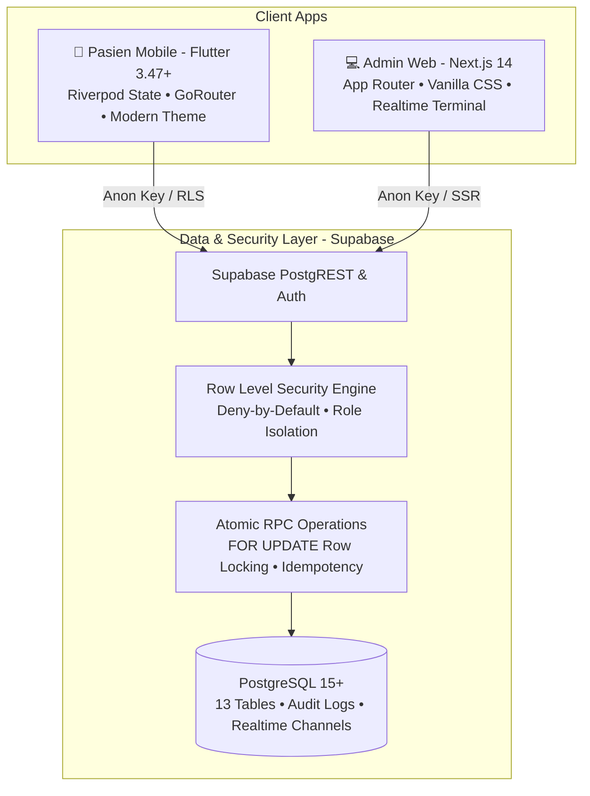

# SIMKlinik — Sistem Informasi Manajemen Klinik (v2)

[](https://flutter.dev)
[](https://nextjs.org)
[](https://supabase.com)
[](https://www.typescriptlang.org)
[](docs/qa-report.md)
[](docs/RLS_MATRIX.md)

**SIMKlinik** adalah platform sistem informasi manajemen klinik modern dan komprehensif yang dirancang untuk fasilitas kesehatan primer (klinik pratama / utama). Menggabungkan **Aplikasi Pasien Mobile (Flutter)** untuk reservasi dokter mandiri dan pelacakan antrean real-time, serta **Dashboard Operasional Web (Next.js)** untuk front office, dokter, dan administrator klinik dengan jaminan keamanan data medis berbasis **Supabase PostgreSQL Row-Level Security (RLS)**.

---

## 🏛️ Arsitektur Sistem

SIMKlinik dibangun dengan arsitektur monorepo modular:



---

## 📂 Struktur Monorepo

```
SIMKlinik/
├── apps/
│   ├── mobile/                    # Aplikasi Pasien Flutter (Android, iOS, Web)
│   │   ├── lib/                   # Arsitektur Riverpod, routing, repositories & views
│   │   ├── test/                  # 12 Unit & Widget tests
│   │   └── pubspec.yaml
│   └── web/                       # Dashboard Admin Klinik Next.js 14 (App Router)
│       ├── app/                   # Rute: /, /queue, /appointments, /schedules, /doctors, /audit
│       ├── components/            # Sidebar, Topbar, dan UI components
│       ├── lib/                   # Supabase client, Mock in-memory store, dan RPC caller
│       ├── test/                  # 6 Unit & Integration tests
│       └── package.json
├── supabase/                      # Konfigurasi Basis Data & Migrasi Terversi
│   ├── migrations/
│   │   ├── 20261014000001_initial_schema.sql        # 13 tabel core, ENUMs, dan index performa
│   │   ├── 20261014000002_rls_policies.sql          # RLS deny-by-default & helper functions
│   │   ├── 20261014000003_atomic_operations.sql     # Stored procedures booking & check-in QR
│   │   └── 20261014000004_booking_queue_engine.sql  # Pembatalan atomik & estimasi waktu antrean
│   ├── seed.sql                   # Data dummy klinik, dokter, spesialisasi, dan jadwal
│   └── tests/                     # Uji pgTAP konkurensi & RLS
├── docs/                          # Dokumentasi Resmi & Laporan Teknis
│   ├── audit-report.md            # Audit baseline repositori dan lingkungan
│   ├── RLS_MATRIX.md              # Matriks keamanan hak akses per role
│   ├── BOOKING_QUEUE_ENGINE.md    # Spesifikasi mesin antrean atomik & state machine
│   └── qa-report.md               # Laporan QA, security review & kesiapan rilis
└── README.md
```

---

## ✨ Fitur-Fitur Utama

### 📱 Aplikasi Mobile Pasien (`apps/mobile`)
1. **Otentikasi & Profil Terisolasi:** Login/Registrasi dengan validasi NIK 16 digit sesuai standar Dukcapil.
2. **Pencarian Dokter & Poli:** Filter interaktif berdasarkan poli spesialisasi (Poli Umum, Gigi & Mulut, Anak, Penyakit Dalam).
3. **Ketersediaan Kuota Real-Time:** Menampilkan kuota slot dokter yang tersisa secara transparan.
4. **Booking Atomik:** Pemilihan anggota keluarga atau diri sendiri dengan pencegahan bentrok kuota.
5. **Tiket Antrean Dinamis:** Kode QR unik untuk check-in mandiri di kios klinik, estimasi rentang waktu tunggu, dan indikator jumlah orang di depan.
6. **Graceful Demo Mode:** Berfungsi penuh secara lokal (in-memory) dengan notifikasi banner jelas saat kredensial Supabase belum terisi.

### 💻 Dashboard Admin Web (`apps/web`)
1. **Ringkasan Operasional (`/`):** Kartu metrik total pasien hari ini, antrean berjalan, kunjungan selesai, dan kapasitas jadwal dokter.
2. **Live Queue Monitor (`/queue`):** Terminal pemanggil antrean real-time dengan tampilan nomor tiket besar dan aksi langsung (*Panggil*, *Mulai Layanan*, *Selesai*, *Lewati*).
3. **Manajemen Reservasi (`/appointments`):** Tabel pencarian data booking, filter status, dan modal pembatalan atomik dengan pencatatan alasan pembatalan.
4. **Jadwal & Kuota Praktik (`/schedules`):** Progress bar keterisian kapasitas vs kuota maksimal per dokter.
5. **Direktori Dokter (`/doctors`):** Katalog data dokter resmi dengan nomor SIP (Surat Izin Praktik) Kemenkes.
6. **Audit Trail Medis (`/audit`):** Rekaman log mutasi sistem dengan inspeksi detail RAW JSON payload.

### 🛡️ Keamanan & Integritas Data (PostgreSQL & RLS)
- **Deny-by-Default RLS:** Tidak ada data yang dapat dibaca atau ditulis tanpa izin eksplisit per-role.
- **Pencegahan Double-Booking:** Transaksi PostgreSQL dengan `SELECT ... FOR UPDATE` mengunci baris slot jadwal sebelum menambah jumlah pasien.
- **Idempotency Key:** Mencegah duplikasi reservasi saat terjadi retry jaringan atau klik ganda.
- **Zero Secret Leak:** Tidak mengekspos `service_role` key pada client Flutter maupun browser web.

---

## 🚀 Panduan Memulai Cepat (Quick Start)

### Prasyarat
- [Flutter SDK](https://flutter.dev) (v3.24+ / direkomendasikan 3.47+)
- [Node.js](https://nodejs.org) (v18+ atau v20 LTS)
- [Google Chrome](https://www.google.com/chrome) atau Edge

---

### 1. Menjalankan Dashboard Admin Web

```powershell
# Masuk ke folder web
cd apps/web

# Install dependencies (jika belum)
npm install

# Jalankan server pengembangan
npm run dev
```
Akses di browser Anda: **[http://localhost:3000](http://localhost:3000)**

---

### 2. Menjalankan Aplikasi Mobile Pasien

```powershell
# Masuk ke folder mobile
cd apps/mobile

# Dapatkan package dependencies
flutter pub get

# Jalankan aplikasi di browser Chrome (tampilan mobile)
flutter run -d chrome
```
*Tips: Pada browser Chrome, buka Developer Tools (F12) lalu klik ikon Device Toolbar (Ctrl+Shift+M) untuk melihat dalam format layar smartphone.*

---

## 🧪 Pengujian & Verifikasi Kualitas

Seluruh pengujian otomatis telah dijalankan dan diverifikasi 100% lulus:

### Menjalankan Uji Mobile (Flutter)
```bash
cd apps/mobile
dart format --output=none --set-exit-if-changed .  # Format check
flutter analyze                                   # Static analysis (0 errors, 0 warnings)
flutter test                                      # 12 Unit & Widget tests
```

### Menjalankan Uji Web (Next.js)
```bash
cd apps/web
npm run typecheck   # TypeScript validation (tsc --noEmit)
npm run test        # 6 Unit & Integration tests
npm run build       # Production static build
```

Hasil laporan audit lengkap tersedia di **[docs/qa-report.md](docs/qa-report.md)**.

---

## ☁️ Menghubungkan ke Supabase Cloud (Staging / Production)

Secara default, SIMKlinik berjalan dalam **Mode Demo** yang mandiri. Untuk menghubungkan ke proyek Supabase nyata:

1. **Jalankan Migrasi Database:**
   ```bash
   npx supabase db push --db-url "postgresql://postgres:[PASSWORD]@[HOST]:5432/postgres"
   ```
2. **Konfigurasi Mobile (`apps/mobile`):**
   ```bash
   flutter run -d chrome \
     --dart-define=SUPABASE_URL="https://your-project.supabase.co" \
     --dart-define=SUPABASE_ANON_KEY="your-anon-key"
   ```
3. **Konfigurasi Web (`apps/web`):**
   Salin `.env.example` ke `.env.local`:
   ```env
   NEXT_PUBLIC_SUPABASE_URL=https://your-project.supabase.co
   NEXT_PUBLIC_SUPABASE_ANON_KEY=your-anon-key
   ```

---

## 📄 Lisensi & Kontribusi

Dikembangkan untuk implementasi Sistem Informasi Manajemen Klinik standar layanan kesehatan primer Indonesia.  
© 2026 SIMKlinik Team.
