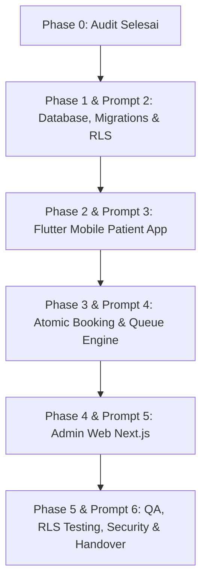

# Laporan Audit Repositori & Kesiapan Lingkungan — SIMKlinik
**Tanggal Audit:** 14 Oktober 2026  
**Auditor:** Senior Software Engineer / Antigravity AI  
**Status Repositori:** Greenfield / Pre-Implementation Phase  
**Target:** Sistem Informasi Manajemen Klinik (SIMKlinik) — Flutter (Mobile) + Next.js (Admin Web) + Supabase (PostgreSQL & Auth)

---

## 1. Ringkasan Eksekutif (Executive Summary)

Audit repositori dilakukan pada direktori kerja `d:\Code\SIMKlinik` berdasarkan instruksi pada `01_AUDIT_REPOSITORY.md`, `MASTER_PROMPT_Antigravity_SIMKlinik.md`, dan `PRD_SIMKlinik.md`.

**Temuan Utama:**
1. **Status Proyek (Greenfield):** Belum ada source code aplikasi (baik Flutter mobile maupun Next.js admin web). Repositori saat ini baru memuat dokumen spesifikasi produk (`PRD_SIMKlinik.md` / `.docx`), draft worksheet kebijakan akses (`RLS_MATRIX_DRAFT.md`), panduan prompt (`prompts/*`), dan `README.md`.
2. **Status Git:** Direktori `d:\Code\SIMKlinik` **belum diinisialisasi sebagai repositori Git** (`fatal: not a git repository`).
3. **Kesiapan Toolchain:**
   - **Flutter & Dart:** Tersedia dan siap pakai (**Flutter 3.47.7 stable**, **Dart 3.13.5**).
   - **Node.js & npm:** Tersedia (**Node v22.17.1**, **npm 10.9.2**).
   - **Supabase CLI:** Dapat dijalankan via `npx supabase@2.120.0`. Belum terpasang secara global di PATH dan belum ada file konfigurasi lokal (`supabase/config.toml`).
   - **Docker:** Belum terpasang / tidak ditemukan di PATH (`docker` command not recognized). Hal ini berpengaruh pada kemampuan menjalankan Supabase local development stack (memerlukan remote Supabase project atau pemasangan Docker Desktop).
4. **Konektivitas Supabase:** Akses Supabase remote belum terkonfigurasi di environment (`SUPABASE_ACCESS_TOKEN` belum disetel). Sesuai aturan keselamatan data dan prompt audit, **tidak ada klaim akses palsu** dan **tidak ada secret yang dicetak**.

---

## 2. Hasil Pemeriksaan Lingkungan & Perintah (Command Output)

Semua pemeriksaan dijalankan secara *read-only* yang aman:

| Komponen | Perintah Diuji | Hasil / Output Ringkas | Status |
|---|---|---|---|
| **Git Status** | `git status` | `fatal: not a git repository (or any of the parent directories): .git` | ⚠️ Belum diinisialisasi |
| **Flutter SDK** | `flutter --version` | `Flutter 3.47.7 • channel stable • Tools Dart 3.13.5 • DevTools 2.60.0` | ✅ Siap |
| **Node.js** | `node --version` | `v22.17.1` | ✅ Siap |
| **npm** | `npm --version` | `10.9.2` | ✅ Siap |
| **Supabase CLI** | `npx supabase --version` | `2.120.0` (dijalankan via npx) | ✅ Tersedia via npx |
| **Docker** | `docker --version` | `docker : The term 'docker' is not recognized...` | ⚠️ Tidak terpasang |
| **Koneksi Supabase** | `npx supabase projects list` | `AccessTokenRequiredError: Access token not provided.` | ⚠️ Belum login / no token |
| **Flutter Doctor** | `flutter doctor` | `[√] Flutter 3.47.7`<br>`[√] Chrome - develop for web`<br>`[!] Android toolchain (cmdline-tools missing)`<br>`[X] Visual Studio Desktop C++ missing`<br>`[√] Connected device (3 available)` | ⚠️ Android SDK butuh cmdline-tools; Web/Chrome siap |
| **Perangkat Flutter** | `flutter devices` | Windows (desktop), Chrome (web), Microsoft Edge (web) | ✅ Target web/browser tersedia |

---

## 3. Struktur Direktori Saat Ini

Struktur folder saat ini di dalam `d:\Code\SIMKlinik`:
```text
d:\Code\SIMKlinik\
└── SIMKlinik_PRD_Antigravity\
    ├── README.md
    ├── docs\
    │   ├── PRD_SIMKlinik.docx
    │   ├── PRD_SIMKlinik.md
    │   └── RLS_MATRIX_DRAFT.md
    └── prompts\
        ├── 01_AUDIT_REPOSITORY.md
        ├── 02_DATABASE_RLS.md
        ├── 03_FLUTTER_MOBILE.md
        ├── 04_BOOKING_QUEUE_ATOMIC.md
        ├── 05_ADMIN_WEB.md
        ├── 06_QA_SECURITY_RELEASE.md
        └── MASTER_PROMPT_Antigravity_SIMKlinik.md
```

**Elemen yang belum ada (Missing Directories/Files):**
- `.git/` & `.gitignore`
- `.env.example`
- `supabase/` (migrations, seed.sql, config.toml)
- `apps/mobile/` atau `simklinik_mobile/` (Flutter project: `pubspec.yaml`, `lib/`, `test/`)
- `apps/web/` atau `simklinik_admin/` (Next.js project: `package.json`, `app/`, `components/`)

---

## 4. Evaluasi Kode, Mock Data, Duplikasi & Konfigurasi

1. **Fitur yang sudah ada:** Belum ada kode implementasi (baru tahap spesifikasi arsitektur & PRD).
2. **TODOs & Debt:** Belum ada hutang teknis kode karena belum ada kode yang ditulis.
3. **Mock Data:** Belum ada mock data dummy di repository.
4. **Duplikasi:** PRD tersedia dalam 2 format (`.docx` dan `.md`) yang sinkron.
5. **Error Handling:** Belum ada implementasi error handling di level aplikasi.
6. **Test Suite:** Belum ada unit test, widget test, maupun integration test.
7. **Build Scripts:** Belum ada script build CI/CD (GitHub Actions, Makefile, dsb.).
8. **Secrets & Environment:** Tidak ditemukan kebocoran secret atau file `.env` di repositori.

---

## 5. Status Supabase & Database Backend

Sesuai instruksi butir 3 pada prompt:
- Supabase CLI dapat dijalankan melalui `npx supabase`.
- Belum ada proyek lokal yang diinisialisasi (`supabase init` belum dijalankan).
- Belum ada skema tabel, fungsi RPC, trigger, migration file, bucket storage, maupun RLS policies aktif di repositori ini.
- Supabase CLI belum terhubung ke remote Supabase project karena `SUPABASE_ACCESS_TOKEN` belum disediakan di environment.
- **Konsekuensi:** Pengembangan database migrations dapat disiapkan secara deklaratif versi SQL (`supabase/migrations/*.sql`) dan disimulasikan/diuji begitu project credentials atau local container tersedia.

---

## 6. Tabel Existing, Gap, Risk, & Rencana Mitigasi

| Area / Modul | Kondisi Existing | Gap Terhadap PRD & Spec | Risiko Teknis | Rencana Mitigasi |
|---|---|---|---|---|
| **Version Control & Git** | Belum ada `.git` | Belum ada riwayat commit, branch, dan ignore rules | Perubahan tidak terlacak, risiko commit file rahasia/besar | Inisialisasi `git init`, buat `.gitignore` ketat (Flutter, Node, Supabase, .env) sebelum menulis kode |
| **Supabase Environment** | Belum ada `supabase/` lokal, Docker tidak ada di host | Belum bisa menjalankan `supabase start` lokal dengan Docker | Mengandalkan remote project Supabase atau memerlukan instalasi Docker Desktop | Gunakan script migrasi SQL terstruktur (`supabase/migrations/`) yang portabel ke remote project via Supabase Dashboard / CLI |
| **Skema Database & RLS** | Baru ada worksheet `RLS_MATRIX_DRAFT.md` | Belum ada skema tabel DDL, RLS policies, indexes, dan triggers | Akses tidak terisolasi antar pasien jika RLS terlupa | Buat file migrasi SQL terstruktur dengan prinsip Deny-by-Default dan RLS ketat pada seluruh tabel |
| **Booking & Queue Atomics** | Konseptual di PRD (US-03, US-04) | Belum ada RPC function/transaksi PostgreSQL untuk booking atomik & antrean | Double-booking slot dokter saat request bersamaan | Buat PostgreSQL RPC function (`book_appointment` & `advance_queue_ticket`) dengan row locking (`FOR UPDATE`) dan constraint unik |
| **Aplikasi Flutter Mobile** | Belum dibuat | Belum ada scaffold Flutter, Riverpod, routing, tema (#106369), dan screen MVP | Inkompatibilitas dependency atau arsitektur tidak modular | Inisialisasi Flutter project dengan clean feature-first architecture (`features/{auth, schedule, booking, queue}`), Riverpod, dan GoRouter |
| **Aplikasi Admin Web** | Belum dibuat | Belum ada project Next.js TypeScript, dashboard, dan Supabase client | Kebocoran `service_role` key di sisi client-side Next.js | Inisialisasi Next.js (App Router) dengan TypeScript, Vanilla CSS/Design System klinik, isolasi strict secret di server actions |
| **Pengujian & CI/CD** | Belum ada test suite | Belum ada automated test untuk RLS, unit logic, dan widget UI | Regresi bug saat integrasi | Buat unit test logic, mock Supabase client test, dan test script terautomasi |

---

## 7. Blocker & Rekomendasi Keputusan Kritis

### A. Blocker Teknis Saat Ini
1. **Docker tidak terpasang di host Windows:** Supabase local dev (`npx supabase start`) memerlukan Docker engine yang aktif.
   - *Solusi A:* Pasang Docker Desktop di Windows jika ingin 100% offline local Supabase.
   - *Solusi B (Rekomendasi Cepat):* Gunakan remote Supabase project gratis (supabase.com) dan link via `npx supabase link --project-ref <REF>` menggunakan personal access token, ATAU siapkan migrasi SQL yang siap di-apply via dashboard SQL Editor.
2. **Android Command-line Tools:** `flutter doctor` mencatat `cmdline-tools component is missing`.
   - *Dampak:* Build APK/Android emulator langsung butuh perbaikan lisensi SDK. Namun untuk preview awal, target **Chrome/Web** (`flutter run -d chrome`) dan testing unit/widget berjalan 100% normal.

### B. Keputusan Struktur Monorepo vs Polyrepo
Untuk menjaga kerapian antara Flutter Mobile, Next.js Admin, dan Supabase:
- **Rekomendasi Struktur:**
  ```text
  d:\Code\SIMKlinik\
  ├── apps\
  │   ├── mobile\             # Flutter project (Patient app)
  │   └── web\                # Next.js project (Admin & Staff dashboard)
  ├── packages\ (opsional)    # Shared models / constants jika diperlukan
  ├── supabase\
  │   ├── migrations\         # Versioned SQL migrations (Schema, RLS, RPC)
  │   └── seed.sql            # Dummy test data (Klinik, Dokter, Spesialisasi)
  ├── docs\                   # Arsitektur, ERD, RLS Matrix, API Spec
  ├── .gitignore
  └── README.md
  ```

---

## 8. Rekomendasi Urutan Implementasi (Next Steps)

Berdasarkan urutan paket prompt (`02_DATABASE_RLS.md` hingga `06_QA_SECURITY_RELEASE.md`):



1. **Langkah Segera (Prasyarat Foundation):**
   - Inisialisasi Git repository (`git init`) di root workspace `d:\Code\SIMKlinik`.
   - Buat `.gitignore` komprehensif yang mencakup Flutter, Dart, Node.js, Next.js, file `.env*`, dan file cache OS.
   - Siapkan folder `supabase/migrations/` dan file inisialisasi skema lengkap sesuai PRD.
2. **Langkah Berikutnya (Sesuai Prompt 02_DATABASE_RLS.md):**
   - Rancang skema database PostgreSQL lengkap: `profiles`, `clinics`, `specialties`, `doctors`, `doctor_schedules`, `appointments`, `queue_sessions`, `queue_tickets`, `queue_events`, `audit_logs`.
   - Implementasikan RLS policies eksplisit (Deny by default, read/write berbasis role & owner).
   - Tulis RPC function untuk booking atomik dan manajemen antrean.
   - Buat `seed.sql` berisi data dummy klinik, dokter, dan jadwal simulasi yang aman.
