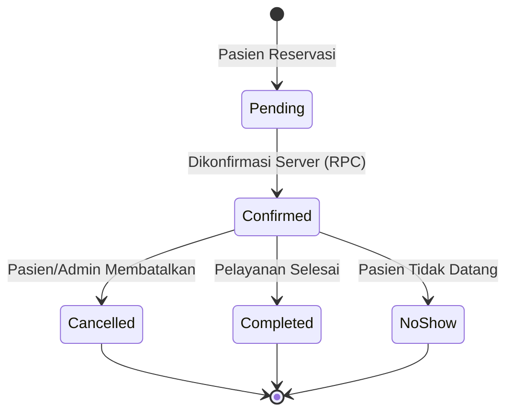
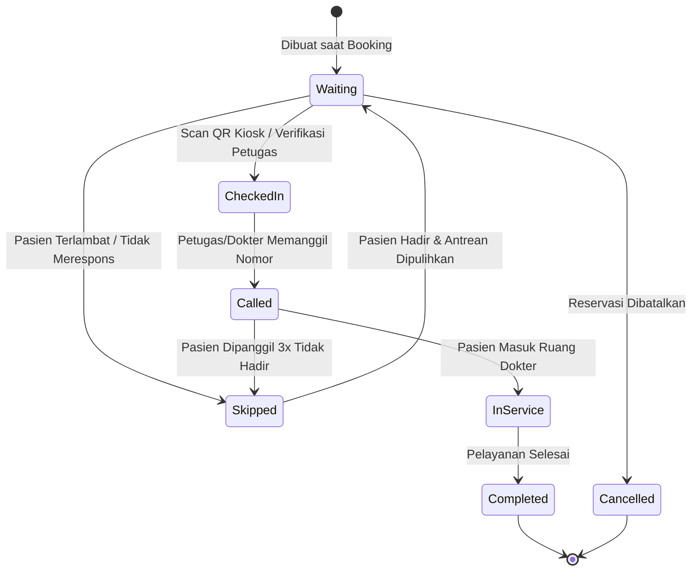

# Spesifikasi Engine Booking Atomik & Manajemen Antrean — SIMKlinik

**Dokumen:** Desain Teknis Konkurensi, State Machine, Idempotency, dan Realtime  
**Versi:** 1.0  
**Stack Backend:** PostgreSQL 15+ / Supabase RPC & RLS  
**Stack Client:** Flutter Mobile & Next.js Admin Web  

---

## 1. State Machine & Transisi Valid

Sistem SIMKlinik memisahkan siklus hidup antara **Reservasi (Appointment)** dan **Operasional Antrean Fisik (Queue Ticket)**.



### A. State Machine: `appointments`
| Status | Deskripsi | Aktor Berwenang | Transisi Berikutnya |
|---|---|---|---|
| **`pending`** | Booking dibuat di sistem sebelum verifikasi slot tuntas. | Sistem / RPC | `confirmed`, `cancelled` |
| **`confirmed`** | Slot dokter terkunci, tiket antrean telah diterbitkan. | Server (RPC) | `completed`, `cancelled`, `no_show` |
| **`cancelled`** | Dibatalkan. Kuota dokter dipulihkan (`booked_count` berkurang). | Pasien / Petugas / Admin | *Final State* |
| **`no_show`** | Pasien tidak hadir hingga jam sesi berakhir. | Petugas / Sistem | *Final State* |
| **`completed`** | Konsultasi dan tindakan medis dokter telah selesai. | Dokter / Petugas | *Final State* |

---

### B. State Machine: `queue_tickets`
Alur penanganan pasien di fasilitas klinik sejak datang hingga selesai:



| Status | Syarat Transisi | Validasi Database (Guard) | Dampak Waktu |
|---|---|---|---|
| **`waiting`** | Tiket diterbitkan saat booking. | Kapasitas slot jadwal masih tersedia. | `created_at = NOW()` |
| **`checked_in`** | Pasien tiba di klinik dan scan QR. | Status sebelumnya harus `waiting`. | `checked_in_at = NOW()` |
| **`called`** | Petugas/Dokter memanggil nomor antrean. | Status sebelumnya `checked_in` atau `waiting`. | `called_at = NOW()` |
| **`in_service`** | Pasien masuk dan konsultasi dimulai. | Status sebelumnya wajib `called`. | `started_at = NOW()` |
| **`completed`** | Pemeriksaan selesai. | Status sebelumnya wajib `in_service`. | `completed_at = NOW()` |
| **`skipped`** | Pasien dipanggil beberapa kali tidak ada. | Petugas/Dokter dengan alasan eksplisit. | Dicatat di `queue_events` |
| **`cancelled`** | Reservasi dibatalkan. | Status awal `waiting` atau `checked_in`. | Tiket non-aktif |

---

## 2. Jaminan Konkurensi & Anti-Overbooking (Atomic Locking)

### Masalah Klasik (Race Condition):
Jika sisa kapasitas slot dokter adalah **1 pasien**, dan dua pasien (A dan B) menekan tombol "Konfirmasi Booking" pada milidetik yang sama:
- Pendekatan Client-Side (`cek slot lalu insert`): Keduanya membaca sisa slot 1, keduanya melakukan INSERT -> **Terjadi Overbooking (Kapasitas jebol)**.

### Solusi SIMKlinik (PostgreSQL Row-Level Locking):
Di dalam RPC function `public.book_appointment_atomic`:
```sql
-- 1. Mengunci baris jadwal dokter secara eksklusif selama transaksi
SELECT * INTO v_schedule
FROM public.doctor_schedules
WHERE id = p_schedule_id
FOR UPDATE;

-- 2. Verifikasi kapasitas di server secara tegas
IF v_schedule.booked_count >= v_schedule.capacity THEN
    UPDATE public.doctor_schedules SET status = 'full' WHERE id = p_schedule_id;
    RAISE EXCEPTION 'Kapasitas slot untuk jadwal dokter ini sudah penuh.';
END IF;

-- 3. Naikkan counter dan terbitkan tiket dalam transaksi yang sama
UPDATE public.doctor_schedules
SET booked_count = booked_count + 1,
    status = CASE WHEN booked_count + 1 >= capacity THEN 'full'::schedule_status ELSE 'available'::schedule_status END
WHERE id = p_schedule_id;
```
**Hasil:** Request kedua yang datang di milidetik yang sama akan tertahan (*queue lock*) hingga request pertama selesai. Ketika request kedua membaca data, `booked_count` sudah sama dengan `capacity`, sehingga transaksi kedua langsung ditolak dengan aman.

---

## 3. Strategi Idempotency (Anti-Duplikasi)

Untuk menangani gangguan koneksi, timeout jaringan di perangkat seluler, atau klik ganda (*double-tap*):
1. Client Flutter membuat UUID unik `idempotency_key` sebelum request dikirim:
   ```dart
   final safeKey = idempotencyKey ?? const Uuid().v4();
   ```
2. Database menyimpan `idempotency_key` dengan constraint `UNIQUE` di tabel `appointments`.
3. Jika request dengan `idempotency_key` yang sama diterima kembali (karena retry otomatis):
   ```sql
   IF p_idempotency_key IS NOT NULL THEN
       SELECT a.id, a.booking_reference, a.status, qt.ticket_code, qt.qr_token
       INTO v_existing_apt
       FROM public.appointments a
       LEFT JOIN public.queue_tickets qt ON qt.appointment_id = a.id
       WHERE a.idempotency_key = p_idempotency_key;

       IF FOUND THEN
           RETURN jsonb_build_object(
               'success', TRUE,
               'is_idempotent_replay', TRUE,
               'appointment_id', v_existing_apt.id,
               'ticket_code', v_existing_apt.ticket_code,
               'message', 'Permintaan booking sudah pernah diproses (Idempotent replay).'
           );
       END IF;
   END IF;
   ```
4. **Jaminan:** Tidak ada slot ganda yang terpotong dan tidak ada nomor tiket kedua yang diterbitkan.

---

## 4. Keamanan Verifikasi QR Check-In

1. **Opaque Token:** Kolom `qr_token` pada `queue_tickets` dibuat secara acak kriptografis (`encode(gen_random_bytes(16), 'hex')`).
2. **Tanpa Data Pribadi:** QR tidak memuat NIK, nama pasien, atau detail rekam medis. Hanya token acak.
3. **Idempotent Check-in:** Jika pasien atau petugas memindai QR yang sama dua kali, RPC `check_in_with_qr` merespons sukses tanpa me-reset riwayat atau menimbulkan error.

---

## 5. Estimasi Waktu Tunggu Dinamis & Transparansi

Sesuai aturan PRD: **Dilarang menjanjikan waktu pasti kepada pasien.**
Sistem SIMKlinik menggunakan kalkulasi rentang (*range estimation*):
$$\text{Jumlah Pasien di Depan} = \sum (\text{tiket dengan nomor lebih kecil yang berstatus waiting / checked\_in / called})$$
$$\text{Min Menit} = \max(5, \text{Jumlah Pasien di Depan} \times 10)$$
$$\text{Max Menit} = \max(15, (\text{Jumlah Pasien di Depan} + 1) \times 20)$$

Tampilan pada UI Flutter:
- Format: `15 - 30 menit (perkiraan)`
- Disclaimer Wajib: *"Waktu merupakan perkiraan dinamis berdasarkan riwayat pelayanan, bukan kepastian waktu panggilan."*
- Timestamp: Menyertakan waktu pembaruan (*Last updated*).

---

## 6. Sinkronisasi Realtime & Strategi Reconnect

1. **Prinsip Utama:** Realtime Supabase hanya digunakan sebagai **sinyal notifikasi pembaruan** (misalnya saat nomor antrean dipanggil oleh dokter).
2. **Reconnect Guard:** Koneksi WebSocket seluler rentan terputus saat pasien berpindah lokasi/jaringan.
3. **Aturan Sinkronisasi:**
   - Klien mendengarkan event `UPDATE` pada channel `queue_tickets:id=eq.<ticket_id>`.
   - Jika status WebSocket berpindah dari `DISCONNECTED` ke `CONNECTED`, klien **wajib melakukan fetch snapshot terbaru** dari REST API database untuk mengeliminasi potensi event yang terlewat (*missed events*).
